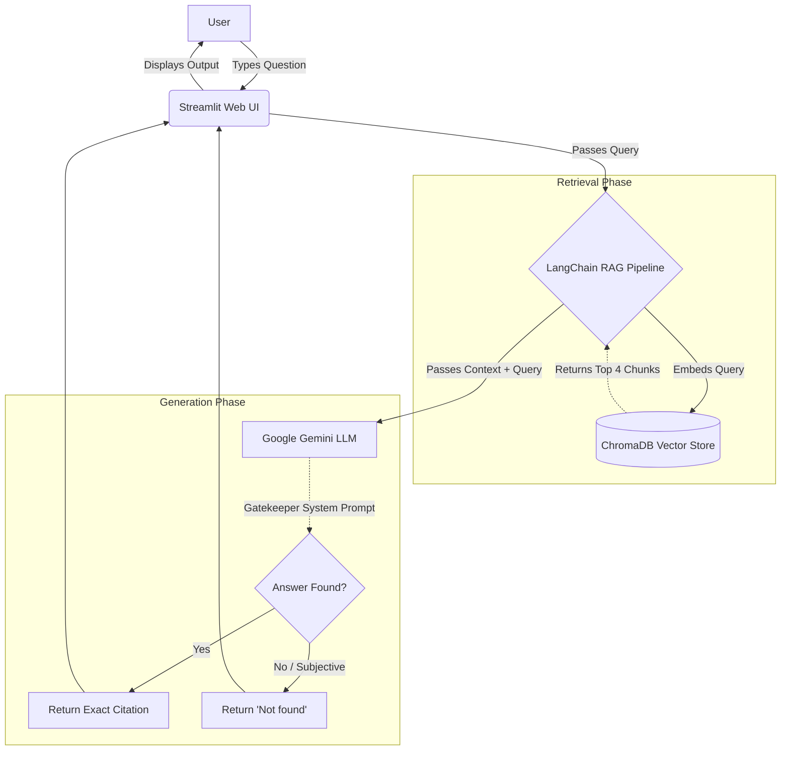

# Project 4 — Book Catalogue Assistant (Orient BlackSwan History Bot)

## 1. Project Title & Overview

The Orient BlackSwan History Bot is a locally hosted, retrieval-augmented
generation (RAG) web application for searching the *Orient BlackSwan History
2024–25* catalogue. Its themed Streamlit interface connects users to a
LangChain pipeline backed by ChromaDB and Google Gemini, providing grounded
answers from the supplied catalogue instead of relying on unsupported external
knowledge.

### Shared Problem Statement

> "Build a RAG system (Python + ChromaDB + LangChain) over the given PDF. It must answer a question from the document with a reference to where the answer is, and reply 'Not found' when the answer is not in the document."

## 2. System Architecture & Tech Stack

### Tech Stack

- **Application Language:** Python
- **RAG Orchestration:** LangChain
- **Vector Store:** ChromaDB
- **Embeddings:** HuggingFace `all-MiniLM-L6-v2`
- **LLM:** Google Gemini `gemini-3.5-flash-lite`
- **Web UI:** Streamlit

### System Flow

1. **Ingestion & Chunking:** `PyPDFLoader` extracts text from the catalogue,
   which is chunked using `RecursiveCharacterTextSplitter` with a chunk size of
   800 characters and a chunk overlap of 150 characters.
2. **Vector Retrieval:** The chunks are embedded with
   `all-MiniLM-L6-v2` and stored in a local ChromaDB vector database. For each
   query, the retriever selects the top four most relevant chunks.
3. **Strict Generation & UI:** A custom Streamlit interface passes each user
   query to the LangChain RAG pipeline. A strict **Gatekeeper** system prompt
   requires the LLM to cite its source or reply exactly `Not found`, preventing
   unsupported or hallucinated answers.



## 3. Setup & Installation

Before running the project, place `History_2024-25.pdf` in the `data/`
directory and configure a valid Gemini API key in `.env`:

```dotenv
GOOGLE_API_KEY=your_gemini_api_key
```

Run the following commands from the project root:

```bash
# Install dependencies
uv pip install -r requirements.txt

# Process the PDF and build the vector database
python src/ingest.py

# Launch the responsive web UI
streamlit run app.py
```

Streamlit will display the local application URL in the terminal, normally
`http://localhost:8501`.

## 4. Evaluation & UI Screenshots

### Evaluation Questions & Output

### Q1: On what date were the prices in this catalogue last updated?

**Answer:** The prices were last updated on 20-01-2025 (Reference: History 2025.indd 88, History 2025.indd 22, History 2025.indd 81, and History 2025.indd 40).


### Q2: In which year was the publisher (Orient BlackSwan) incorporated?

**Answer:** Orient BlackSwan was incorporated in 1948.

Reference: Page 1 (History 2025.indd 1)


### Q3: What is the price of a Physics textbook?

**Answer:** Not found


### Q4: Who is the current Minister of Education?

**Answer:** Not found


### Q5: Which is the "best" history book for a beginner?

**Answer:** Not found


